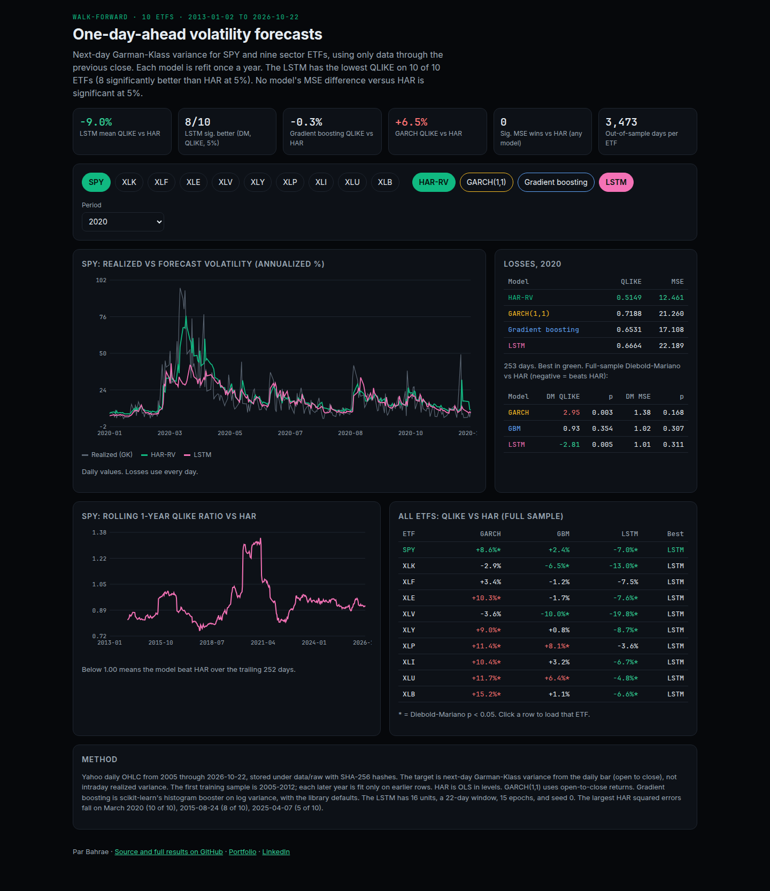
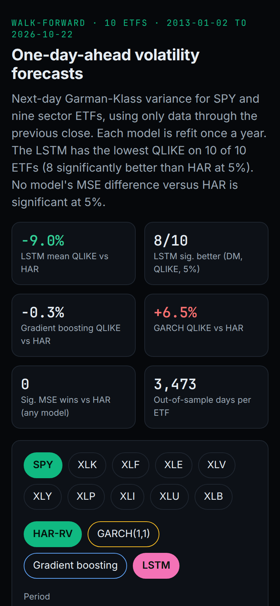

# vol-forecast-ml

[](https://github.com/ParBproject/vol-forecast-ml/actions/workflows/ci.yml)

One-day-ahead realized-volatility forecasts for SPY and the nine SPDR sector ETFs (XLK, XLF, XLE, XLV, XLY, XLP, XLI, XLU, XLB).
HAR-RV and GARCH(1,1) are compared with gradient boosting and a small LSTM.
Evaluation is walk-forward, with QLIKE, MSE, and Diebold-Mariano tests against HAR.
`scripts/build_readme.py` writes the numbers below from `results/summary.json`.

**Live app: [parbproject.github.io/vol-forecast-ml](https://parbproject.github.io/vol-forecast-ml/)**

| Desktop | Mobile |
|---|---|
|  |  |

## Results

- Out of sample: 3,473 trading days per ETF, 2013-01-02 to 2026-10-22, 10 ETFs.
- QLIKE: the LSTM is lowest on 10 of 10 ETFs. Mean QLIKE is 0.2968 versus 0.3262 for HAR (-9.0%). The Diebold-Mariano improvement over HAR is significant at 5% on 8 of 10. Gradient boosting's mean QLIKE is -0.3% versus HAR (significantly better on 2, worse on 2). GARCH's mean QLIKE is +6.5% versus HAR and significantly worse on 7.
- MSE: HAR is lowest on 5 of 10 ETFs, gradient boosting on 4, and the LSTM on 1. No model's MSE difference versus HAR is significant at 5% on any ETF. The five largest HAR squared errors are 40% to 94% of each ETF's total MSE, mostly March 2020 (10 of 10), 2015-08-24 (8 of 10), 2025-04-07 (5 of 10). Squared error does not separate the models. The QLIKE gap does not show that the LSTM forecasts the large variance jumps more closely than HAR.

## Mean loss across the 10 ETFs

| Model | QLIKE | vs HAR | QLIKE wins | DM sig. better / worse | MSE | vs HAR | MSE wins | DM sig. better / worse |
|---|---:|---:|---:|---:|---:|---:|---:|---:|
| HAR | 0.3262 | +0.0% | 0 | - / - | 10.212 | +0.0% | 5 | - / - |
| GARCH | 0.3473 | +6.5% | 0 | 0 / 7 | 10.350 | +1.3% | 0 | 0 / 0 |
| GBM | 0.3251 | -0.3% | 0 | 2 / 2 | 9.327 | -8.7% | 4 | 0 / 0 |
| LSTM | 0.2968 | -9.0% | 10 | 8 / 0 | 9.803 | -4.0% | 1 | 0 / 0 |

## Per-ETF QLIKE (best in bold; DM stat vs HAR, negative = better than HAR, * = p < 0.05)

| ETF | HAR | GARCH | GBM | LSTM | DM GARCH | DM GBM | DM LSTM |
|---|---:|---:|---:|---:|---:|---:|---:|
| SPY | 0.3978 | 0.4319 | 0.4073 | **0.3701** | +2.95* | +0.93 | -2.81* |
| XLK | 0.4250 | 0.4127 | 0.3975 | **0.3698** | -1.35 | -2.55* | -4.13* |
| XLF | 0.3656 | 0.3779 | 0.3613 | **0.3383** | +0.63 | -0.19 | -1.00 |
| XLE | 0.2482 | 0.2738 | 0.2440 | **0.2295** | +2.79* | -0.86 | -5.08* |
| XLV | 0.3769 | 0.3632 | 0.3391 | **0.3022** | -1.52 | -2.99* | -5.16* |
| XLY | 0.3297 | 0.3595 | 0.3323 | **0.3009** | +2.41* | +0.29 | -3.43* |
| XLP | 0.2842 | 0.3166 | 0.3072 | **0.2740** | +3.97* | +3.08* | -1.78 |
| XLI | 0.3211 | 0.3545 | 0.3314 | **0.2997** | +3.20* | +1.26 | -4.82* |
| XLU | 0.2414 | 0.2696 | 0.2567 | **0.2298** | +3.92* | +3.22* | -4.20* |
| XLB | 0.2716 | 0.3129 | 0.2747 | **0.2537** | +4.12* | +0.41 | -2.90* |

## Per-ETF MSE (daily variance in %², best in bold)

| ETF | HAR | GARCH | GBM | LSTM | DM GARCH | DM GBM | DM LSTM |
|---|---:|---:|---:|---:|---:|---:|---:|
| SPY | **1.839** | 2.713 | 2.139 | 2.500 | +1.38 | +1.02 | +1.01 |
| XLK | 28.041 | 25.827 | **25.024** | 25.577 | -0.82 | -1.12 | -0.90 |
| XLF | 28.989 | 25.578 | **24.292** | 25.149 | -0.80 | -1.12 | -0.91 |
| XLE | 7.165 | 10.570 | **7.071** | 8.585 | +1.40 | -0.09 | +1.29 |
| XLV | 21.762 | 20.179 | 20.009 | **19.963** | -1.04 | -1.13 | -1.15 |
| XLY | 3.548 | 4.664 | **3.085** | 3.986 | +1.25 | -1.59 | +0.74 |
| XLP | **1.081** | 1.293 | 1.185 | 1.277 | +1.12 | +1.09 | +1.00 |
| XLI | **5.142** | 6.154 | 5.366 | 5.437 | +1.23 | +0.68 | +0.61 |
| XLU | **1.830** | 2.603 | 1.872 | 2.003 | +1.65 | +0.25 | +0.62 |
| XLB | **2.725** | 3.915 | 3.228 | 3.554 | +1.33 | +0.91 | +0.95 |

## Data

- Prices: yfinance (Yahoo Finance) daily OHLC, auto_adjust=False, 10 ETFs (SPY, XLK, XLF, XLE, XLV, XLY, XLP, XLI, XLU, XLB). Requested 2005-01-01 to 2026-10-23 (end exclusive). Downloaded 2026-10-23T14:01:52+00:00.
- `data/raw/` has 11 files (one CSV per ETF and `meta.json`). SHA-256 hashes are in `data/MANIFEST.json`. `make verify` fails if a file has changed.
- `make fetch` downloads the files again. That changes the hashes and the results.
- The CSVs are in the repo so this study can be rerun. Yahoo's terms still apply if the files are reused.

## Method

- The target is next-day Garman-Klass variance from open, high, low, and close, in %². It is an open-to-close range proxy, not intraday realized variance.
- Walk-forward, expanding window. The first training sample is 2005-2012. Each model is refit once per calendar year on rows dated before that year, and the forecast for day t+1 uses rows through day t only. `tests/test_methods.py` checks the timestamps and checks that scrambling later rows leaves earlier forecasts unchanged.
- HAR-RV: OLS of rv[t+1] on the daily, 5-day, and 22-day mean rv, in levels.
- GARCH(1,1): constant mean, normal errors, fit with `arch` on open-to-close percent returns.
- Gradient boosting: scikit-learn `HistGradientBoostingRegressor` with library defaults, on log rv. Features are log rv (daily, weekly, monthly), the open-to-close return, the 5-day return sum, and the absolute overnight gap. The forecast is exp(prediction + half the training residual variance).
- LSTM: PyTorch, one layer of 16 units, 22-day windows of the same features, 15 epochs, Adam at 1e-3, seed 0, log-rv target.
- Those settings are constants in `src/volml/models.py`. There is no search over them.
- Losses are QLIKE = rv/f - log(rv/f) - 1 and MSE on the variance. Diebold-Mariano tests compare each model with HAR using Newey-West variance (5 lags) and two-sided normal p-values. All models are scored on the same dates.

## Caveats

- QLIKE fits a log target, and MSE fits OLS in levels. Both losses are reported.
- The Yahoo bars are used as stored, with no edits. On 2019-02-26, XLI's high in `data/raw/XLI.csv` is 82.66 and the close is 76.30. That day ranks 2 among XLI's five largest HAR squared errors. The row is left as downloaded.
- The 10 ETFs move together, so 10 tests are not 10 separate studies. There is no multiple-testing correction.
- LSTM training uses a fixed seed. Another PyTorch build can move the forecasts slightly.

## Reproduce

```bash
python -m venv .venv && .venv/bin/pip install -e ".[dev]"
make all      # verify hashes, walk-forward study (~4 min CPU), README, web data, ruff, pytest
make web      # web app tests + build (Node 20+)
make deploy   # publish web/dist to gh-pages
```

## License

MIT
